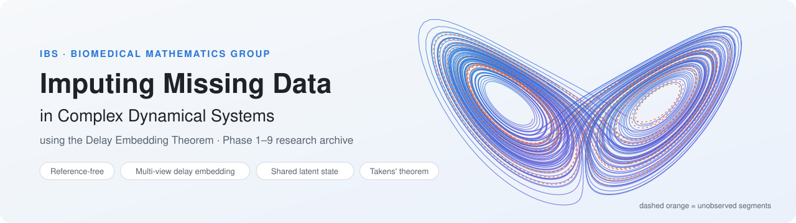
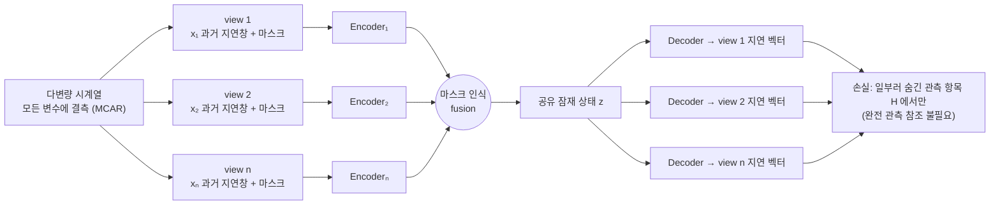
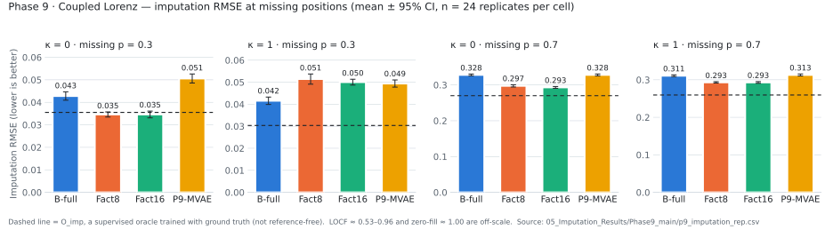
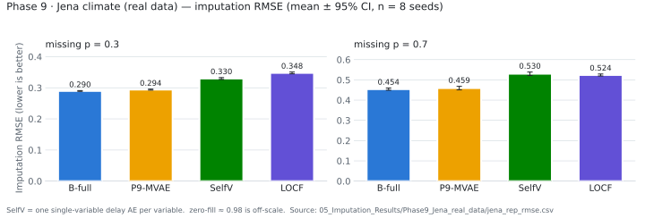

<div align="center">

<picture>
  <source media="(prefers-color-scheme: dark)" srcset="assets/banner_dark.svg">
  
</picture>

<br/>

[](09_Reproducibility/environment/versions.txt)
[](09_Reproducibility/code_snapshot/requirements.txt)
[](01_Research_Synthesis/research_timeline.md)
[](research_experiment_master_table.csv)
[](09_Reproducibility/sha256_manifest.txt)
[](https://woominju.github.io/Imputing-Missing-Data/)

**완전 관측 변수 없이, 여러 불완전 지연 view를 하나의 공유 잠재 상태로 통합해 결측을 대치할 수 있을까?**

[📊 대시보드](https://woominju.github.io/Imputing-Missing-Data/) ·
[⏱️ 10분 요약](research_key_findings.md) ·
[📘 통합 보고서](01_Research_Synthesis/phase1_to_phase9_research_synthesis.md) ·
[🧮 정리 색인](02_Mathematical_Foundations/key_theorems_index.md) ·
[🔁 재현 안내](09_Reproducibility/reproduction_guide.md)

</div>

---

## 🎯 Official AIM

> *We aim to develop a dynamics-informed imputation framework that reconstructs missing values in multivariate time series **without requiring any fully observed variable**. It does so by learning a **shared latent state** to which the **delay embeddings of all variables** are mapped consistently, as implied by **Takens' embedding theorem**.*

| # | 구성 요소 | |
|:-:|---|---|
| 1 | 동역학 기반 결측 대치 | Dynamics-informed Missing-data Imputation |
| 2 | 완전 관측 참조 변수 없음 | No Fully Observed Reference Variable |
| 3 | 다중 view 지연 매장 | Multi-view Delay Embedding |
| 4 | 일관된 공유 잠재 상태 | Consistent Shared Latent State |
| 5 | 수학적 대응과 식별성 | Mathematical Correspondence and Identifiability |
| 6 | 시뮬레이션 카오스 계와 실제 자료 | Simulated Chaotic Systems and Real-world Data |
| 7 | FPRM 및 기존 방법과의 공정 비교 | Fair Comparison with FPRM and Existing Methods |

<sub>원문: [`00_Official_AIM/OFFICIAL_AIM.md`](00_Official_AIM/OFFICIAL_AIM.md)</sub>

## 📌 목차

- [배경](#-배경)
- [방법 개요](#-방법-개요)
- [핵심 결과](#-핵심-결과)
- [결과 그림](#-결과-그림)
- [AIM 진척](#-aim-진척)
- [Phase 1–9 연표](#%EF%B8%8F-phase-19-연표)
- [모델](#-모델)
- [저장소 구조](#-저장소-구조)
- [시작하기 & 재현](#-시작하기--재현)
- [데이터·라이선스 고지](#%EF%B8%8F-데이터라이선스-고지)
- [인용 & 감사의 글](#-인용--감사의-글)

## 🌀 배경

- **지연 매장 정리** (Takens 1981; Sauer–Yorke–Casdagli 1991; Deyle–Sugihara 2011) — generic한 관측 함수의 지연 좌표 사상은 끌개 위의 임베딩이 된다. 하지만 이 문제에서는 (i) 관측 함수가 **고정된 좌표 사영**이고, (ii) 결측 때문에 **지연 벡터의 일부 좌표가 지워진다** — 정리를 그대로 적용할 수 없다.
- **FPRM** (*Nat. Commun.* 2026, [DOI 10.1038/s41467-026-77922-1](https://doi.org/10.1038/s41467-026-77922-1)) — 가우스 과정으로 **완전 관측된 참조 변수 하나**의 지연 벡터에서 다른 변수를 복원한다. 이 연구는 바로 그 참조 변수 가정을 없애려 한다.
- **실험 시스템** — Lorenz, 결합 Lorenz(6차원, κ = 0 / 1), 실제 자료(Jena climate 등). 결측은 모든 변수에 MCAR로 건다.

## 🧠 방법 개요



- **참조 없는 학습** — 관측된 항목 중 일부를 무작위로 숨기고(H), 그 항목만 복원하도록 학습한다. 조기 종료도 validation의 숨긴 관측 항목만 쓴다.
- **숨은 상태**(예: Lorenz의 y)는 학습에 쓰지 않고 평가(readout, 검색)에만 쓴다.
- 모든 확증 실험은 **사전등록 + 프로토콜 고정(`PROTOCOL_FREEZE_*.txt`) + 독립 재계산**으로 진행했다.

## 🔬 핵심 결과

라벨: `증명` 수학적 증명 · `인증` 수학 명제 + 통계적 하/상한 · `확증` 사전등록 검정 통과 · `서술` 경험적 관찰

### ✅ 수학적으로 확립된 것

| | 결과 | 근거 |
|:-:|---|---|
| 1 | **완전 관측 참조 없이 학습할 수 있다** — MCAR·양성 조건에서 숨긴 관측 항목 손실의 최적해는 조건부 기댓값 E[X<sub>u</sub> \| X<sub>b</sub>] (Fisher 일관성) | `증명` Phase 9 A4.1 |
| 2 | **무조건 cross-mask 정렬은 불가능하다** — Lorenz 부호반전 대칭 때문에 모든 마스크에서 같은 잠재를 강제하면 상태 구별성을 잃는다 | `증명` P7 → A2.2 |
| 3 | **공유 잠재가 임베딩이 되는 조건부 정리** — 정확한 등식이 성립하면 T는 C¹ 임베딩 (식별 마스크에서만) | `증명` A3.1 |
| 4 | **대칭 기반 정보 하한** — X0층 Bayes 위험 ≥ 0.6679, B-full 위험의 83% 이상이 정보 한계 | `증명`+추정 Phase 8 N1-X0 |

### 🧪 실험으로 확인된 것 (사전등록, 독립 복제본 n = 24)

- **상대 view에는 자기 숨은 상태 정보가 있고, 모델은 그 일부를 쓴다** — 다만 효과는 실질 기준 0.02 미만으로 작다 (Phase 6 S1R, Phase 8 IIa).
- **잠재가 6차원 상태를 담는지는 감독 범위가 결정한다** — B-full − B-self의 RMSE<sub>s6</sub> = −0.37 (24/24). κ = 0에서도 같으므로 결합 활용의 증거는 아니다 (Phase 7).
- **모델 한계가 존재한다** — B-full 파이프라인에 관측 정보 대비 ≥ 0.041 MSE의 초과 오차 (Phase 8 I-1).

### ⚠️ 가장 중요한 부정적 결과

> [!IMPORTANT]
> - 결합 공유 잠재(**B-full**)가 하위계별 병치(**Fact8**)보다 낫다는 것은 **확증되지 않았다**. p = 0.7 대치에서는 오히려 병치가 낫고, Phase 9 독립 자료에서 **재현**됐다.
> - Phase 9의 수학적으로 정당화된 **tower 자기 증류(P9-MVAE)도 B-full을 개선하지 못했다** (P-1 대치 +0.0021, 반대 방향).
> - Phase 3C의 "FDR 일관성 개선"은 평가 지표 오류로 **무효** 처리했다 (3D-1 정정).
> - FPRM과의 **같은 정보 조건 공정 비교는 아직 수행되지 않았다**.

부정적 결과와 정정·철회 기록도 모두 그대로 포함했습니다 → [`EXCLUDED_FILES_INDEX.md`](EXCLUDED_FILES_INDEX.md) 하단 참고.

## 📈 결과 그림

<picture>
  <source media="(prefers-color-scheme: dark)" srcset="assets/phase9_imputation_dark.svg">
  
</picture>

결합 Lorenz에서 p = 0.7이면 병치(Fact8/Fact16)가 결합 인코더(B-full)보다 일관되게 낮은 오차를 보이고, P9-MVAE는 B-full을 넘지 못합니다. 점선은 정답으로 지도학습한 oracle(O_imp)로, 비지도 AE와의 격차를 보여 줍니다.

<picture>
  <source media="(prefers-color-scheme: dark)" srcset="assets/jena_imputation_dark.svg">
  
</picture>

실제 자료(Jena)에서는 다중 view(B-full)가 변수별 자기 AE(SelfV)와 LOCF보다 낫습니다(서술 실험, 같은 계열의 seed 8개).

<sub>그림은 저장소 안의 CSV에서 직접 그렸습니다: [`05_Imputation_Results/`](05_Imputation_Results)</sub>

## 🧭 AIM 진척

| 구성 요소 | 상태 | 요약 |
|---|:-:|---|
| 완전 관측 변수 없이 대치 | 🟢 **Established** | A4.1(수학) + 모든 모델이 참조 없이 학습, LOCF·zero보다 크게 낮은 RMSE |
| 다중 view 지연 매장 통합 | 🟡 **Partially Supported** | 상대 view 정보 존재(인증)·활용(확증, 작음). 결합 인코더 우위는 없음 |
| 일관된 공유 잠재 상태 | 🔴 **Unresolved** | G3·GSR 기준 미달, P9 개입 효과 미미, 비식별 마스크의 원리적 한계 |
| Takens형 수학적 대응·식별성 | 🔴 **Unresolved** | 조건부 정리(A3.1)만 있음. 학습 모델이 가정을 만족한다는 증거 없음 |
| 시뮬레이션과 실제 자료 검증 | 🟡 **Partially Supported** | 결합 Lorenz는 사전등록 확증 설계, 실제 자료는 서술 |
| FPRM 및 기존 방법과의 공정 비교 | ⚪ **Not Evaluated** | 원본 FPRM은 참조 변수 필요. Lag-FPRM 미구현, Python 포트 결함 미해결 |

<sub>상세: [`01_Research_Synthesis/aim_alignment.md`](01_Research_Synthesis/aim_alignment.md)</sub>

## 🗓️ Phase 1–9 연표

| Phase | 날짜 (2026) | 핵심 질문 | 핵심 결론 |
|:-:|:-:|---|---|
| [1](04_Core_Experiments/Phase1_2_early) | 10-24 → 10-27 | 다중 view 지연 AE가 모든 변수 MCAR에서 대치를 할 수 있는가? | 참조 없는 조건에서 작동. z 참조 FPRM은 대칭 때문에 실패 |
| [2 / 2.5](04_Core_Experiments/Phase2_5) | 10-27 | 부분 관측 식별성의 수학과 구조 설계 | 무조건 점 일관성은 정보를 붕괴시킴(P7). PoE 정확성 주장 철회 |
| [3A–3D](04_Core_Experiments/Phase3) | 10-27 | FDR(전체 지연 재구성)이 숨은 상태 정보를 늘리는가? | 숨은 정보↑ 대치↓ trade-off. 3C 결과는 평가 오류로 무효 |
| [4](04_Core_Experiments/Phase4) | 10-27 | 결합 Lorenz에서 다중 view 결합이 도움이 되는가? | p에 따라 decoder 효과의 부호가 바뀜 |
| [5](04_Core_Experiments/Phase5) | 10-28 | 상대 view 입력이 자기 숨은 y를 개선하는가? | H2 미지지 (B−A +0.0137) |
| [6](04_Core_Experiments/Phase6) | 10-28 | 정보 존재·사용·좌표의 분리 | 대칭 기반 정보 하한. κ = 0 음성 대조 실패(미해결) |
| [7](04_Core_Experiments/Phase7) | 10-28/29 | 학습 목표가 잠재의 6차원 상태 보존을 바꾸는가? | RMSE<sub>s6</sub> −0.37 (24/24) — 감독 범위의 효과 |
| [8](04_Core_Experiments/Phase8) | 10-29 → 10-31 | 정보 한계 vs 모델 한계, 결합 인코더 vs 병치 | 모델 한계 ≥ 0.041 MSE. B-full > Fact8 미확증 |
| [9](04_Core_Experiments/Phase9) | 10-31 | tower 자기 증류가 공유 상태 학습과 대치를 개선하는가? | P-1 실패. Phase 8 부정적 결과 재현 |

<sub>40건 실험 전체(15개 열): [`research_experiment_master_table.csv`](research_experiment_master_table.csv)</sub>

## 🧩 모델

| 모델 | 정의 | 코드 |
|---|---|---|
| **FDR** (Full Delay Reconstruction) | view별 인코더 → 공유 잠재 → view별 **전체 지연 벡터** 디코더, 숨긴 관측 항목에서만 중복도 가중 MSE | [`03_Core_Models/FDR`](03_Core_Models/FDR) |
| **B-self / B-full** (ArmModel) | FDR + 마스크 인식 학습 fusion. B-full은 모든 view 손실, B-self는 자기 view 손실만 | [`03_Core_Models/Bfull_Bself_ArmModel`](03_Core_Models/Bfull_Bself_ArmModel) |
| **Fact8 / Fact16** | 하위계별 ArmModel 2개를 연결한 병치(잠재 8+8 / 16+16) | [`03_Core_Models/Fact8_Fact16`](03_Core_Models/Fact8_Fact16) |
| **P9-MVAE** | B-full + tower 자기 증류 손실 L<sub>tow</sub> (teacher = 같은 망, no-grad) | [`03_Core_Models/P9_MVAE`](03_Core_Models/P9_MVAE) |

## 📂 저장소 구조

```text
Imputing-Missing-Data/
├── index.html                    # 📊 오프라인 대시보드 (GitHub Pages로도 공개)
├── 00_START_HERE.md              # 읽는 순서 안내
├── research_key_findings.md      # 10분 요약
├── research_experiment_master_table.csv   # 실험 40건 × 15열
├── 00_Official_AIM/              # AIM 원문
├── 01_Research_Synthesis/        # 통합 보고서 · 연표 · AIM 정합성 · 상세 인벤토리
├── 02_Mathematical_Foundations/  # 정리·인증·반례·철회 색인, 미해결 문제, 수학 원문 13편
├── 03_Core_Models/               # FDR · B-self/B-full · Fact8/16 · P9-MVAE 핵심 코드
├── 04_Core_Experiments/          # Phase 1–9 보고서 · 사전등록 프로토콜 · 고정 기록 · 분석 CSV
├── 05_Imputation_Results/        # Phase 1 실제 자료 · Phase 8 Family III · Phase 9 main · Jena
├── 06_Baseline_Comparisons/FPRM/ # FPRM 비교 프로토콜 · Python 포트 보고서 · 공식 MATLAB 코드(CC BY 4.0)
├── 07_Independent_Verification/  # Phase 5–9 검증 번들(ZIP) · 독립 재계산 스크립트와 출력
├── 08_Future_Research/           # 향후 연구 계획
├── 09_Reproducibility/           # 환경 · 전체 코드 스냅샷 · 재현 안내 · 파일 목록 · SHA-256
├── assets/                       # README 배너와 그림
├── EXCLUDED_FILES_INDEX.md       # 포함하지 않은 자료와 확보 방법
└── ARCHIVE_README.md             # 아카이브 원본 README
```

## 🚀 시작하기 & 재현

**1. 둘러보기** — 대시보드를 [온라인](https://woominju.github.io/Imputing-Missing-Data/)으로 보거나, 저장소를 받아 `index.html`을 더블클릭하면 됩니다(인터넷·서버 불필요).

```bash
git clone https://github.com/Woominju/Imputing-Missing-Data.git
cd Imputing-Missing-Data
```

**2. 무결성 확인** — 아카이브 루트에서 실행합니다.

```bash
sha256sum -c 09_Reproducibility/sha256_manifest.txt
```

**3. 코드 실행** — 전체 코드는 [`09_Reproducibility/code_snapshot`](09_Reproducibility/code_snapshot)에 있습니다.

```bash
cd 09_Reproducibility/code_snapshot
pip install -r requirements.txt          # Python 3.10 · torch 2.5.1 · numpy 2.2.6 · scipy 1.15.3 · pandas 2.3.3
python tests/test_smoke.py               # shape · leakage · alignment · gradient 점검
python experiments/run_lorenz.py --models A,B,C,D --tau 1 --epochs 150 --patience 15
python experiments/run_coupled_lorenz.py --models C,D --kappas 0.0,0.5,2.0 --tau 1
```

**4. 서버 없이 재검산** — Phase 8은 검증 번들 안의 `audit_scripts/recompute_from_bundle.py`가 모든 확증 판정을 다시 계산하고, Phase 9 번들에는 `eval/` 복제본 480개와 검증 스크립트가 들어 있습니다 → [`07_Independent_Verification`](07_Independent_Verification)

<details>
<summary><b>재현에 포함되지 않은 것</b> (용량 때문에 제외, 결정적으로 재생성 가능)</summary>

<br/>

- 시뮬레이션 궤적(약 1.7 GB): 각 phase의 `gen*.py`와 seed 규칙으로 다시 만듭니다.
- 학습 checkpoint(약 1.4 GB)와 Phase 8 oracle(905 MB): GPU로 재학습합니다. 해시는 각 phase의 고정 파일과 `FULL_DATA_LIST`에 있습니다.
- 실험 환경: NVIDIA L40S, CUDA 12.4.

자세한 내용은 [`09_Reproducibility/reproduction_guide.md`](09_Reproducibility/reproduction_guide.md)와 [`EXCLUDED_FILES_INDEX.md`](EXCLUDED_FILES_INDEX.md)를 보세요.
</details>

## ⚖️ 데이터·라이선스 고지

- **실제 자료(EEG, ENSO, Exchange, Transportation, Wind, Jena, Beijing 등)의 원본은 포함하지 않았습니다.** 재배포 조건이 기록되지 않았기 때문이며, 원 출처(예: FPRM Figshare [10.6084/m9.figshare.30446765](https://doi.org/10.6084/m9.figshare.30446765))에서 받을 수 있습니다.
- [`06_Baseline_Comparisons/FPRM/fprm_official`](06_Baseline_Comparisons/FPRM/fprm_official)의 MATLAB 코드는 FPRM 저자들의 코드로 **CC BY 4.0**을 따릅니다(출처는 `PROVENANCE.md`). FPRM 논문 PDF는 재배포 금지라 제외했습니다.

## 📝 인용 & 감사의 글

이 연구를 참고하신다면 저장소 오른쪽의 **"Cite this repository"** 를 이용하거나 아래를 사용해 주세요.

```bibtex
@misc{woominju2026imputing,
  title  = {Imputing Missing Data in Complex Dynamical Systems using Delay Embedding Theorem},
  author = {Woominju},
  year   = {2026},
  note   = {Phase 1--9 research archive, IBS Biomedical Mathematics Group},
  url    = {https://github.com/Woominju/Imputing-Missing-Data}
}
```

멘토 **Dongju Lim** 님의 지도에 감사드립니다. 이 연구는 **IBS Biomedical Mathematics Group (BIMAG)** 에서 진행되었습니다.

<div align="center">
<sub>Made with 🌀 by <a href="https://github.com/Woominju">@Woominju</a></sub>
</div>
